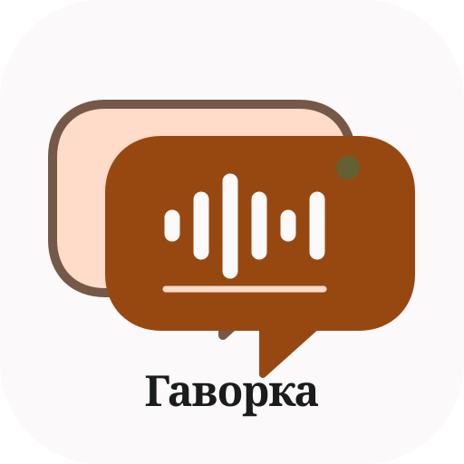

<div align="center">



# 🎙️ Havorka

**Полевой помощник исследователя · Field Assistant for Ethnographers & Sociolinguists**  
*Запись · Разметка · Анализ — в одном офлайн-приложении*

[](#-web--pwa)
[](https://github.com/Sargon-II/Havorka/releases/latest)
[](https://react.dev/)
[](https://capacitorjs.com/)
[](LICENSE)

[🇧🇾 Беларуская](#-беларуская) · [🇷🇺 Русский](#-русский) · [🇬🇧 English](#-english) · [🇨🇳 中文](#-中文)

[🌐 Web (PWA)](https://sargon-ii.github.io/Havorka/) · [📱 Android APK](https://github.com/Sargon-II/Havorka/releases/latest) · [🐞 Issues](https://github.com/Sargon-II/Havorka/issues)

</div>

---

## 🇧🇾 Беларуская

**Havorka** (ад бел. *гаворка* — гутарка, гаворка мясцовасці) — бясплатны open-source інструмент даследчыка-этнолага, фалькларыста і сацыялінгвіста для палявой фіксацыі і структуравання фальклорна-дыялектных матэрыялаў у Беларусі. Працуе як PWA у браўзеры і як Android-прыкладанне, не патрабуе інтэрнэту ў полі.

### ✨ Магчымасці

- 🧩 **Візуальны канструктар апытальнікаў** — збірайце анкеты і сцэнарыі інтэрв'ю без кода
- 🎙️ **Убудаваны аўдыёзапіс** з таймкодамі, прывязанымі да пытанняў і рэплік
- 🗂️ **Пашпарт сесіі** — інфармант, месца, дата, умовы запісу
- 🗣️ **Аналіз білінгвізму і спантаннай мовы** — перамыкане кодаў, беларуска-рускае мяшанне, трасянка
- 🏺 **Анатацыя культурных артэфактаў** — каталог этнаграфічных фота і прадметаў
- 📴 **Offline-first** — усе даныя застаюцца на вашай прыладзе

### 👥 Для каго

Этнографы, фалькларысты, дыялектолагі, сацыялінгвісты, гісторыкі, антраполагі, студэнты і аспіранты гуманітарных спецыяльнасцей.

---

## 🇷🇺 Русский

**Havorka** (от бел. *гаворка* — речь, говор местности) — бесплатный open-source инструмент исследователя-этнолога и социолингвиста для полевой фиксации и структурирования фольклорно-диалектологических материалов в Беларуси. Работает как PWA в браузере и как Android-приложение, интернет в поле не нужен.

### ✨ Возможности

| | Функция | Что даёт |
| :---: | :--- | :--- |
| 🧩 | **Визуальный конструктор опросников** | Анкеты и сценарии интервью без программирования |
| 🎙️ | **Встроенная аудиозапись** | Таймкоды, привязанные к вопросам и репликам |
| 🗂️ | **Паспорт сессии** | Информант, место, дата, условия записи |
| 🗣️ | **Анализ билингвизма и спонтанной речи** | Код-свитчинг, белорусско-русское смешение, трасянка |
| 🏺 | **Аннотирование культурных артефактов** | Каталог этнографических фото и предметов |
| 📴 | **Offline-first** | Все данные остаются на вашем устройстве |

### 🎯 Для кого

Этнографы, фольклористы, диалектологи, социолингвисты, историки, антропологи, студенты и аспиранты гуманитарных специальностей.

### 🔬 Чем отличается от QDA-систем

Классические инструменты качественного анализа (NVivo, MAXQDA, ATLAS.ti, Taguette, QualCoder) начинают работу с готового транскрипта. **Havorka** охватывает путь «поле → анализ» целиком: от составления опросника и записи в деревне до разметки материала, с учётом восточноевропейского языкового контекста (билингвизм, код-свитчинг, трасянка).

---

## 🇬🇧 English

**Havorka** (from Belarusian *havorka* — speech, a local dialect) is a free, open-source field research toolkit for ethnographers, folklorists and sociolinguists. It supports fieldwork data collection and structuring of folklore and dialectological material, with a focus on Belarus and the East Slavic bilingual context. It runs as an offline-first PWA and as a native Android app.

### ✨ Features

- 🧩 **Visual questionnaire builder** — design interview guides and surveys without code
- 🎙️ **Built-in audio recording** with timestamps linked to questions and utterances
- 🗂️ **Session passport** — informant, location, date, recording conditions
- 🗣️ **Bilingualism & spontaneous speech analysis** — code-switching, Belarusian–Russian mixing, trasianka
- 🏺 **Cultural artifact annotation** — catalogue of ethnographic photos and objects
- 📴 **Offline-first** — data stays on your device

### 🔬 How it differs from QDA software

NVivo, MAXQDA, ATLAS.ti, Taguette and QualCoder start from a finished transcript. **Havorka** covers the full field-to-analysis pipeline: from designing the questionnaire and recording in the field to coding the material, tailored to Eastern European language contexts.

> **Keywords:** ethnography · fieldwork app · sociolinguistics · dialectology · folklore · oral history · code-switching · bilingualism · Belarus · Belarusian · interview recording · questionnaire builder · qualitative research · digital humanities · PWA · offline-first · Android · React · Capacitor

---

## 🇨🇳 中文

**Havorka**（源自白俄罗斯语 *havorka*，意为“话语、方言”）是一款免费开源的民族学与社会语言学田野调查工具，用于在白俄罗斯进行民俗与方言材料的田野采集与结构化整理。它既可作为离线优先的 PWA 网页应用使用，也提供 Android 安装包。

### ✨ 功能

- 🧩 **可视化问卷构建器** — 无需编程即可设计访谈提纲与问卷
- 🎙️ **内置录音** — 时间码与问题、发言片段关联
- 🗂️ **访谈档案** — 受访者、地点、日期、录音条件
- 🗣️ **双语与自发言语分析** — 语码转换、白俄—俄语混用、特拉夏恩卡（trasianka）
- 🏺 **文化器物标注** — 民族志照片与器物目录
- 📴 **离线优先** — 数据保存在本地设备

### 🎯 适用人群

民族学家、民俗学家、方言学家、社会语言学家、历史学者、人类学者及人文学科的学生与研究生。

---

## 📥 Скачать · Download · Спампаваць · 下载

### 🌐 Web / PWA
[https://sargon-ii.github.io/Havorka/](https://sargon-ii.github.io/Havorka/) — откройте в браузере и выберите «Установить на главный экран».

### 📱 Android APK
[Releases](https://github.com/Sargon-II/Havorka/releases/latest) — скачайте готовый `.apk` и разрешите установку из доверенного источника.

### 💻 Исходный код
```bash
git clone https://github.com/Sargon-II/Havorka.git
cd Havorka
```

---

## 🛠️ Разработка · Development

```bash
# Установка зависимостей / install dependencies
npm install

# Сервер разработки / dev server
npm run dev

# Веб-сборка с поддержкой PWA / web build with PWA
npm run build

# Нативная сборка без PWA / native build
npm run build:native
```

**Стек · Stack:** React 19 · Vite · TypeScript · PWA (Service Worker) · Capacitor (Android) · Tailwind CSS · GitHub Actions

---

## 🤝 Вклад · Contributing

Issues и pull requests приветствуются / Issues and PRs are welcome.

---

## 📄 Лицензия · License

Проект распространяется под свободной лицензией [Apache 2.0](LICENSE).

---

<div align="center">

🌾 *Havorka — гаворка жыве, пакуль яе запісваюць.*

</div>
